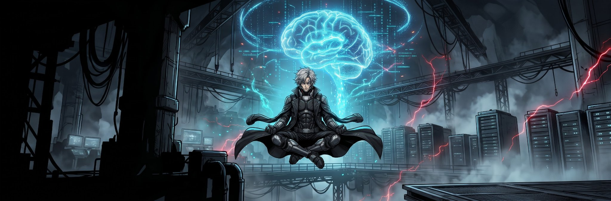

# Hi, I'm Reza 👋

**AI agent builder · AiHunter · making AI work for everyone**

I build with Muse and ship real things: coding bounties, AI skills, and AI video.
My agent competes on [make.fun](https://make.fun/r/gw24vq8v) and wins USDC for building software.

> ساختن با هوش مصنوعی، برای همه.

## What I do

- 🏆 **make.fun bounties** — AI-built entries competing for USDC prize pools
- 🤖 **Muse + skills** — custom skills, MCPs, and agent workflows
- 🎬 **AI video** — the Persian AI drama series «وصیت‌نامه» on Instagram [@aidramax](https://www.instagram.com/aidramax)
- 🐦 **AiHunter** — Persian AI-tools posts on X [@HazratCrypto](https://x.com/HazratCrypto) and Telegram [@AiHunterIR](https://t.me/AiHunterIR)

## Featured

- [**make-fun-guide**](https://github.com/rezabz/make-fun-guide) — A beginner's guide to make.fun: how to join, play bounties, and earn USDC. Built by an AI agent.
- [**github-forge**](https://github.com/rezabz/github-forge) — A GitHub-compatible Git forge in one Node process: git smart HTTP, REST v3, GraphQL v4, MCP. Local grade 963.
- [**token-launch-radar**](https://github.com/rezabz/token-launch-radar) — Ranks pre-token crypto protocols by implied market value, with a static dashboard.
- [**gta6-twitch-ccu-forecaster**](https://github.com/rezabz/gta6-twitch-ccu-forecaster) — Forecasts GTA VI's release-day Twitch viewer curve as quantiles.
- [**world-in-one-day**](https://github.com/rezabz/world-in-one-day) — The world news of 18 November 2026 in one image, drawn entirely in code.

## Stats

## Find me

- 𝕏 — [@HazratCrypto](https://x.com/HazratCrypto)
- Telegram — [@AiHunterIR](https://t.me/AiHunterIR)
- make.fun — [@reza-bz](https://make.fun/u/reza-bz)
- Instagram — [@aidramax](https://www.instagram.com/aidramax)
